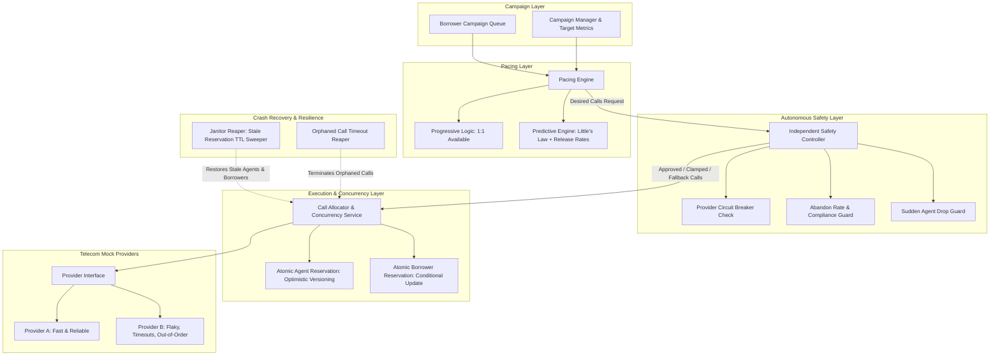
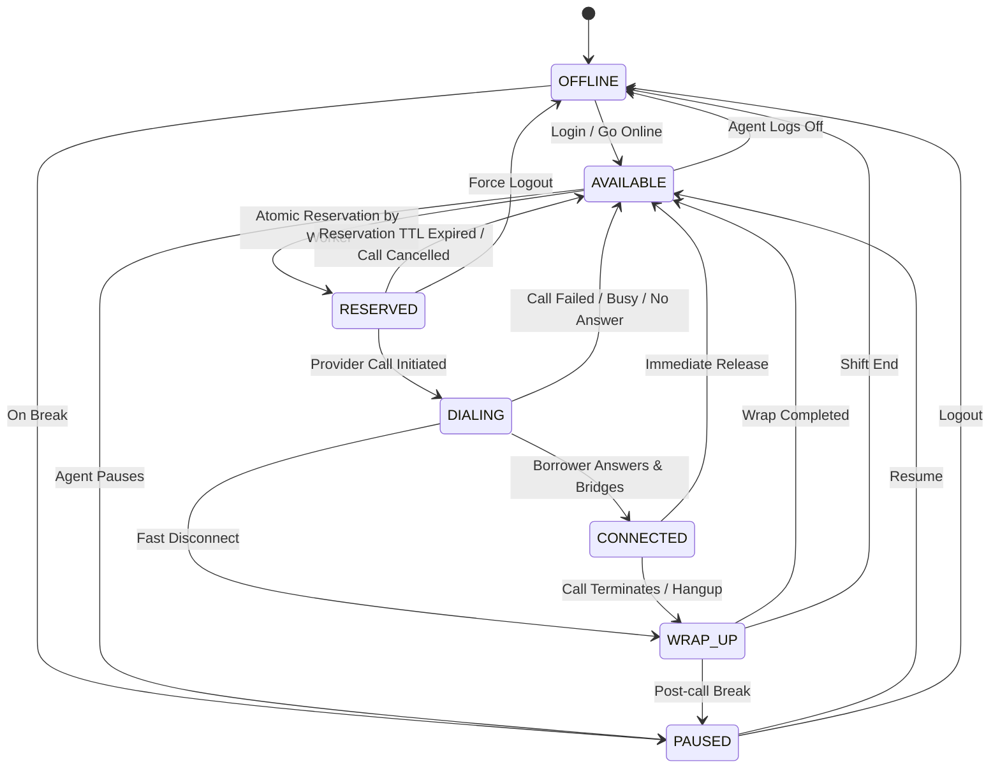
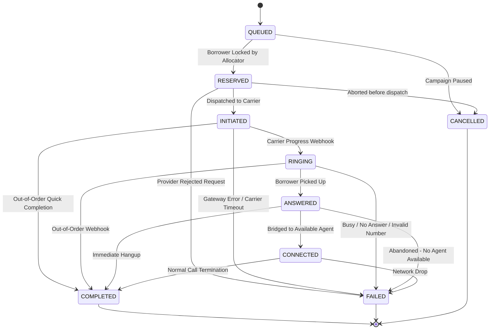

# System Architecture & State Machines

This document outlines the architecture, decision pipeline, and explicit state machines powering the **CredResolve SmartDialer**.

---

## 1. High-Level Component Pipeline

The SmartDialer strictly enforces the architectural boundary specified in the CredResolve requirements: the predictive pacing engine **never** directly initiates outbound calls. An **Independent Safety Controller** acts as an unbypassable gatekeeper.

---

## 2. Agent State Machine

Agents transition through strict, validated states. Transitions outside this graph trigger an `InvalidAgentStateTransitionException`.

### Agent Transition Matrix

| From State | Allowed Target States | Trigger / Mechanism |
|---|---|---|
| `OFFLINE` | `AVAILABLE`, `PAUSED` | Agent manual login |
| `AVAILABLE` | `RESERVED`, `CONNECTED` (dynamic bridge), `PAUSED`, `OFFLINE` | Atomic allocation (`version = version + 1`) |
| `RESERVED` | `DIALING`, `AVAILABLE`, `PAUSED`, `OFFLINE` | Call dispatch or TTL expiry (Reaper) |
| `DIALING` | `CONNECTED`, `AVAILABLE`, `WRAP_UP` | Carrier webhook (ANSWERED / FAILED) |
| `CONNECTED` | `WRAP_UP`, `AVAILABLE` | Call termination webhook (COMPLETED) |
| `WRAP_UP` | `AVAILABLE`, `PAUSED`, `OFFLINE` | Agent disposition submission |
| `PAUSED` | `AVAILABLE`, `OFFLINE` | Agent toggle |

---

## 3. Call State Machine

Calls represent outbound dial attempts. The state machine incorporates **idempotent handling** for duplicate provider events and **graceful reconciliation** for out-of-order carrier webhooks.

### Out-of-Order & Duplicate Event Matrix

| Scenario | State Machine Behavior | Outcome |
|---|---|---|
| Duplicate `ANSWERED` received | Detected via `current_state == to_state` or `current_state == CONNECTED`. | Idempotent no-op. Returns `is_duplicate = True`. |
| `COMPLETED` arrives before `ANSWERED` (Provider B) | Directly transitions from `INITIATED` or `RINGING` to `COMPLETED`. Recorded talk duration applied. | Handled cleanly with `is_out_of_order = True`. |
| Delayed `ANSWERED` arrives after `COMPLETED` | Detected as terminal state trailing event. | Safely ignored with `is_stale = True`. Call remains `COMPLETED`. |
| Worker crashes after reservation | Stale reservation reaper sweeps `Agent.reserved_at < now - 10s`. | Agent returned to `AVAILABLE`, Borrower returned to `QUEUED`. |

---

## 4. Safety Controller Decision Logic

The Safety Controller evaluates five orthogonal invariant layers before approving any call dispatch:

1. **Zero Agent Invariant**: If $A_{avail} = 0$, $A_{wrap} = 0$, and $C_{conn} = 0$, reject all calls.
2. **Circuit Breaker Check**: If telecom provider circuit is `OPEN` or `HALF_OPEN`, reject speculative calls or enforce strict progressive fallback.
3. **Regulatory Abandonment Ceiling**: If recent abandoned calls $> 0$ or abandon rate $> 1.0\%$, immediately revert predictive mode to 1:1 progressive mode.
4. **Answer Rate Collapse Protection**: If answer rate $< 10\%$, switch to progressive mode to avoid queue saturation and carrier spam score penalties.
5. **Binomial UCL Capacity Ceiling**: Enforces $P(\text{Answers} > \text{Capacity}) \le \alpha$ (where $\alpha = 0.01$). Even during high model confidence, approved calls are clamped to this statistical ceiling to prevent over-subscription bursts.
